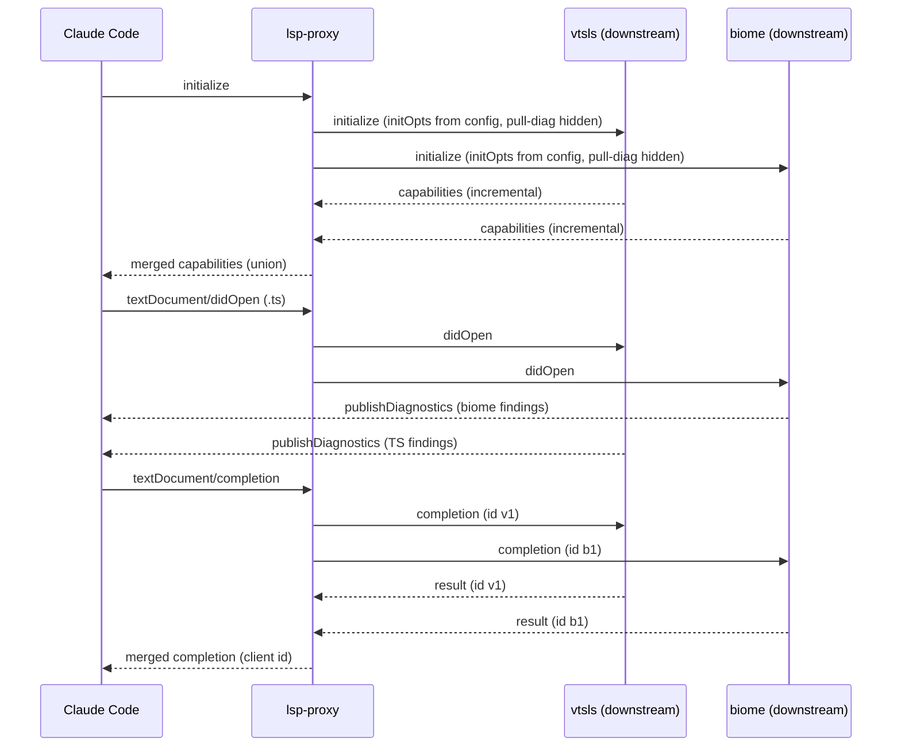

# LSP proxy POC — design

Date: 2026-10-20 · Status: approved design (brainstorm sections 1–4 corrected; addenda 1–4 folded in) · Bean: cc-sdd-hi1x
Branch: `feature/lsp-proxy` · Package: `packages/lsp-proxy/` · Plugin: `plugins/lsp-proxy/`

## 1. Context and problem

Claude Code registers LSP servers through a plugin's `.lsp.json`
(`command`, `args`, `extensionToLanguage`, `transport`, `maxRestarts`,
`initializationOptions`, `settings`; format reference:
`plugins/biome-lsp/.lsp.json`). Registration is exclusive per extension:
when two plugins map the same extension, only the first-registered server
starts. This was verified empirically (bean cc-sdd-6jwd,
`docs/multi-lsp-collision-handling.md`): per-extension exclusivity, no
fan-out, no per-capability split. Consequence: biome diagnostics and the
TypeScript server (vtsls plugin) cannot coexist — vtsls owns `.ts`, biome
pushes nothing for TypeScript files.

## 2. Goal and acceptance

Build a stdio LSP proxy in Bun that Claude Code registers exactly once.
The proxy fans out to N downstream stdio LSP servers (target pair:
vtsls + biome), merges their results, and returns everything to Claude
Code as a single server.

**Acceptance (live, owner-run):** proxy binary built, plugin registered,
and the biome-lsp and vtsls Claude Code plugins disabled by the owner
(the proxy spawns vtsls itself via its config — a registered vtsls plugin
would conflict on `.ts` and double-run the server); a `.ts` file
containing a biome-detectable issue and a TypeScript type error shows
BOTH diagnostic sources in Claude Code; hover works via vtsls.

**Non-goals (POC):** full-sync document translation, forwarding of
server-initiated workspace edits (`workspace/applyEdit`,
`workspace/executeCommand`), diagnostics deduplication, lazy server
spawn, semantic tokens, rename, non-stdio transports, non-darwin-arm64
targets.

## 3. Owner decisions (binding)

| # | Decision |
|---|---|
| D1 | Live acceptance with the real pair biome + vtsls; core behavior proven by TDD tests on stub servers. |
| D2 | Registration as a new sibling plugin `plugins/lsp-proxy/`; the biome-lsp and vtsls Claude Code plugins are disabled/removed by the owner (vtsls was disabled ahead of testing, then re-enabled temporarily for development sessions) — never by agents. |
| D3 | Downstream configuration lives ONLY in `packages/lsp-proxy/lsp-proxy.config.json`. The `.lsp.json` carries no `initializationOptions`/`settings` — per-server options and settings are proxy-config fields. |
| D4 | Full merge semantics: set-valued results concatenate; hover contents join; single-document results resolve by config priority order (asked sequentially, first non-null wins). |
| D5 | Architecture: modular merge-proxy, eager spawn of all configured servers at `initialize`, parse-everything (every message is decoded to JSON; no raw byte passthrough paths). |
| D6 | Downstream servers must support incremental sync (`textDocumentSync: 2`); anything else is rejected at startup with a stderr log. |
| D7 | The proxy hides the client's `textDocument/diagnostic` capability from downstream servers, forcing the push model (`publishDiagnostics`) which the proxy can forward and merge (technique from techee/lsp-proxy). |
| D8 | Development is strictly TDD: RED → GREEN → REFACTOR per module; plan tasks carry explicit RED and GREEN steps. |
| D9 | Binaries are built through a shared private package `packages/bin-builder/` (`@cc-sdd/bin-builder`): `buildBinary({ entrypoints, binName })` owns the compile config once and writes every binary to `~/.local/bin/<binName>`. `packages/cli-hook/build.ts` is refactored to a thin wrapper (behavior unchanged); `packages/lsp-proxy/build.ts` is the same wrapper with `binName: "lsp-proxy"`. The `.lsp.json` invokes the bare binary name. Task 1 of the plan, before any lsp-proxy module. |
| D10 | Each downstream server carries its own `extensionToLanguage` map in the proxy config (keys drive routing). The plugin `.lsp.json`'s `extensionToLanguage` is a GENERATED artifact — the `sync-extensions` command unions all server maps into it; the file is never hand-maintained. |
| D11 | Process control uses ONLY Bun's native types and surface (verified in `bun-types@1.4.2/bun.d.ts`): `Bun.spawn` called directly (no injection, no casts — `const` generics infer `Subprocess<"pipe","pipe","inherit">` from the literal options), `onExit` callback as the exit event, `AbortSignal` per server, `pid` read straight off the child. The registry of running downstream servers is the in-memory `Map` of server-name → child (pids ride on the `Subprocess` objects; no pidfiles, no JSON state, no state directory, no `--kill-all`). Session teardown needs none of it: empirically (md-lsp-probe, 2026-10-20, `tmp/md-lsp-probe.log`) Claude Code terminates its LSPs with the protocol `shutdown` request immediately followed by SIGTERM — the proxy's existing handlers (shutdown request, exit notification, stdin EOF, SIGTERM) each cascade to the children from memory. Accepted limitation: a SIGKILLed proxy leaves its children orphaned (no recovery mechanism; out of POC). |

## 4. Architecture

`packages/lsp-proxy/src/` — one module, one responsibility. All modules
except `downstream.ts`, `proxy.ts`, `main.ts`, `kill-all.ts` are pure (no
I/O); that purity is the TDD surface.

| Module | Responsibility | I/O |
|---|---|---|
| `framing.ts` | Incremental byte-stream ↔ JSON-RPC message codec: `Content-Length` framing, partial chunks, several messages per chunk, resync after a malformed frame | pure |
| `config.ts` | Load + validate `lsp-proxy.config.json` | file read injected |
| `router.ts` | (URI, method) → set of downstream servers: extension map keys + declared-capability filter | pure |
| `mux.ts` | Pending-request table: client id → (server, server id); cancel tracking | pure |
| `merge.ts` | Merge responses per result shape | pure |
| `capabilities.ts` | `initialize` merge: capability union, pull-diagnostics hiding, sync policy | pure |
| `docstore.ts` | Track latest open-document texts: apply didChange content changes (full + incremental); feeds respawn replay (6.1) | pure |
| `downstream.ts` | Spawn + supervise one server — `Bun.spawn` with native types, `onExit`, per-server `AbortSignal`, `kill()`, `pid`, `exited` | I/O |
| `proxy.ts` | Orchestration of both directions; the `servers: Map<string, Downstream>` IS the in-memory registry (D11) | I/O |
| `main.ts` | parseArgs (config positional), wire `Bun.stdin`/`Bun.stdout`, SIGTERM handler | I/O |
| `build.ts` | Thin wrapper over `@cc-sdd/bin-builder` (6.4) | I/O |
| `sync-extensions.ts` | Generate the plugin `.lsp.json` extension map from the config (6.6); pure core + thin CLI | file I/O |

Data flow: Claude Code → `Bun.stdin` → framing → proxy (routing) → mux
(new per-server ids) → downstream stdin → downstream stdout → framing →
mux (reverse mapping) → merge (when several pending) → `Bun.stdout`.



## 5. Protocol

### 5.1 Lifecycle

- Client `initialize` → spawn ALL configured servers (eager, D5); forward
  to each: client capabilities MINUS `textDocument.diagnostic` (D7),
  per-server `initializationOptions` from the proxy config (D3),
  `rootUri`/`workspaceFolders` unchanged. Wait for all.
- Merged `initialize` result (see `capabilities.ts`): providers OR-ed;
  `textDocumentSync` advertised as incremental (2) — every downstream must
  report 2, otherwise that server is rejected at startup with a stderr log
  (D6); `serverInfo` identifies the proxy.
- `initialized` notification → all servers. `shutdown` → all; respond to
  the client after all respond. `exit` and client stdin EOF → cascade
  teardown (6.1).

### 5.2 Server→client requests

| Request | Proxy behavior |
|---|---|
| `workspace/configuration` | Answer itself from the server's `settings` field in the proxy config; the same object is returned for every requested section |
| `client/registerCapability`, `window/workDoneProgress/create` | Respond `null` (silently accept), log to stderr |
| Any other server→client request (`workspace/applyEdit`, `workspace/executeCommand`) | Respond `MethodNotFound` error + log; never forwarded (non-goal) |

### 5.3 Routing

- Document notifications (`didOpen`/`didChange`/`didClose`/`didSave`) →
  every server whose `extensionToLanguage` map contains the URI's
  extension.
- Client requests → every server matching the extension AND declaring the
  method's capability.
- Unknown methods → fan-out to extension owners, first non-null response
  by config priority wins.

### 5.4 Merge rules (per result shape)

| Result shape / methods | Rule |
|---|---|
| Set arrays: `definition`, `references`, `documentSymbol`, `codeAction` | Concatenate; `codeAction/resolve` routed back to the originating server (actions are tagged with their origin in `data`) |
| `completion` | Merge `CompletionList`: `items` concatenated, `isIncomplete` = OR; a null list counts as empty |
| `hover` | Contents joined (all `MarkupContent` → joined with blank line) |
| Single-document results: `formatting`, `rangeFormatting` | Servers are asked sequentially in config-priority order; the first non-null result wins (lower-priority servers are never asked, so no cancellations are needed) |
| Unknown methods | First non-null by priority (see 5.3) |
| Per-server null | Skipped; per-server error → merge the successes; all errored → error to client |
| `publishDiagnostics` | Forwarded to the client as-is from each server, no dedup |

`$/cancelRequest` from the client is remapped and forwarded to all
pending servers. Server-initiated `$/`-notifications are dropped (log);
`window/logMessage`/`showMessage` are logged to stderr.

## 6. Operations

### 6.1 Downstream supervision

- Spawn exactly per the documented options, with native types only (D11):

  ```ts
  Bun.spawn({
    cmd: [server.command, ...server.args],
    env: { ...process.env, ...server.env },
    onExit: (subprocess, exitCode, signalCode) => { /* exit event */ },
    signal: perServerAbortController.signal,
    stderr: "inherit",
    stdin: "pipe",
    stdout: "pipe",
  })
  ```

  The return value's type is inferred (`Subprocess<"pipe", "pipe",
  "inherit">`) — no casts, no custom process types. `onExit` may run
  before `Bun.spawn` returns (documented) — handlers must tolerate that.
- The proxy keeps the running registry in memory: `servers:
  Map<string, Downstream>`; each `Downstream` holds its `Subprocess`
  (hence `pid`). Nothing is written to disk (D11).
- The proxy tracks the latest text of every open document (it observes
  all `didOpen`/`didChange` passing through).
- Server exit → stderr log → single respawn → re-`initialize` → replay
  `didOpen` with the tracked texts. Second death → server marked dead,
  proxy continues without it. All dead → proxy stays alive, client
  requests fail with errors.
- Teardown (client `exit`, stdin EOF, proxy SIGTERM): `kill("SIGTERM")`
  to every child; exit resolves from the children's `exited` promises;
  any straggler is SIGKILLed after a 2s grace, then the proxy exits 0.
  Children are killed explicitly, so bun's parent-waits-for-children
  behavior never blocks exit (`unref()` is not used).

### 6.2 Error handling

- Malformed frame on any stream → resync to the next `Content-Length`
  header, log to stderr.
- Unparseable downstream stdout → same resync path.
- Both read loops are wrapped in a top-level catch: log + degrade, never
  crash the proxy.

### 6.3 Configuration — `lsp-proxy.config.json`

Array order = priority for single-result methods (D4). Each server's
`extensionToLanguage` map keys drive routing (D10).

```json
{
  "servers": [
    {
      "args": ["--stdio"],
      "command": "vtsls",
      "extensionToLanguage": {
        ".cjs": "javascript",
        ".js": "javascript",
        ".jsx": "javascriptreact",
        ".mjs": "javascript",
        ".ts": "typescript",
        ".tsx": "typescriptreact"
      },
      "initializationOptions": {},
      "name": "vtsls",
      "settings": {}
    },
    {
      "args": ["lsp-proxy"],
      "command": "biome",
      "extensionToLanguage": {
        ".cjs": "javascript",
        ".css": "css",
        ".js": "javascript",
        ".json": "json",
        ".jsonc": "json",
        ".jsx": "javascriptreact",
        ".mjs": "javascript",
        ".ts": "typescript",
        ".tsx": "typescriptreact"
      },
      "initializationOptions": {},
      "name": "biome",
      "settings": {}
    }
  ]
}
```

Both commands resolve on PATH (verified 2026-10-20: `vtsls` →
`~/.bun/bin/vtsls`, `biome` → `/opt/homebrew/bin/biome`; bare names,
PATH inherited from Claude Code). Validation: `name` non-empty and
unique; `command` non-empty; `extensionToLanguage` non-empty, keys start
with `.`, values non-empty; two servers mapping the same extension to
DIFFERENT languages is a validation error; `args`, `env`,
`initializationOptions`, `settings` optional. The config path is a CLI
argument with the package file as default.

### 6.4 Binary builder — shared package (D9)

`packages/bin-builder/` (`@cc-sdd/bin-builder`, private, no runtime
deps) owns the build logic once instead of per-package copies:

- Exports `buildBinary({ entrypoints, binName })` carrying the current
  `packages/cli-hook/build.ts` semantics: `Bun.build` with `compile` +
  `bytecode` + `minify` + `sourcemap: "linked"`, target
  `bun-darwin-arm64`, `autoloadBunfig: false`, `autoloadDotenv: false`,
  outfile `~/.local/bin/<binName>`, failure → throw; wrappers print and
  exit 1. The pure part (options/outfile derivation, error mapping) is
  unit-tested with `Bun.build` injected; the thin run function stays
  untested I/O.
- `packages/cli-hook/build.ts` → thin wrapper:
  `buildBinary({ entrypoints: ["./src/main.ts"], binName:
  "claude-code-cli-hook" })`. Behavior unchanged; `build-bin` script
  untouched.
- `packages/lsp-proxy/build.ts` → the same wrapper with
  `binName: "lsp-proxy"`.
- Constraint (isolated by probe, 2026-10-20, bun 1.4.3): `bytecode: true`
  compilation rejects top-level `await` in the entrypoint — bundled
  `main.ts` files wrap their body in `async function main()` +
  `void main().catch(...)` instead. Run-only scripts (`build.ts`,
  `sync-extensions.ts`, test fixtures) keep top-level await freely.
- Workspace wiring: consumers declare `@cc-sdd/bin-builder:
  "workspace:*"` in `devDependencies` (manifest edits are planned
  steps; `bun install` and the lockfile are owner actions — agents
  never install).
- Plan ordering: the shared package (TDD) + the cli-hook refactor is
  Task 1, before any lsp-proxy module.

### 6.5 Registration — `plugins/lsp-proxy/`

```
plugins/lsp-proxy/
├── .claude-plugin/plugin.json   # name: lsp-proxy
├── .lsp.json                    # minimal, transport only (D3);
│                                 # extensionToLanguage is GENERATED (D10)
└── README.md                    # build prerequisite + requirements
```

`.lsp.json` — no `initializationOptions`, no `settings`; all downstream
configuration lives in the proxy config (D3); the extension map is
produced by `sync-extensions` (6.6), never edited by hand:

```json
{
  "lsp-proxy": {
    "args": ["/Users/vasilsokolik/www/cc-sdd/packages/lsp-proxy/lsp-proxy.config.json"],
    "command": "lsp-proxy",
    "extensionToLanguage": {
      ".cjs": "javascript",
      ".css": "css",
      ".js": "javascript",
      ".json": "json",
      ".jsonc": "json",
      ".jsx": "javascriptreact",
      ".mjs": "javascript",
      ".ts": "typescript",
      ".tsx": "typescriptreact"
    },
    "transport": "stdio",
    "maxRestarts": 3
  }
}
```

Bare `lsp-proxy` command resolves on PATH from `~/.local/bin` (same
pattern as the security-guard hook). The absolute config path follows the
biome-lsp precedent for absolute paths. README documents: `bun run
build-bin` prerequisite, `bun run sync-extensions` after every config
edit (D10), `bun` required at build time only (binary is standalone),
and both downstream commands resolvable on PATH. If
`.claude-plugin/marketplace.json` enumerates plugins, add the entry;
`claude plugin validate .` must stay green.

### 6.6 `sync-extensions` — generated extension map (D10)

`packages/lsp-proxy/src/sync-extensions.ts` + package script
`sync-extensions` (`bun run sync-extensions`). Two pure functions + a
thin CLI:

- `extensionUnion(config)`: union of all servers' `extensionToLanguage`
  maps; the config validator's cross-server conflict rule (6.3) guards
  the union — same extension → different language is an error.
- `mergeIntoLspJson(lspJsonText, union)`: parses the plugin `.lsp.json`,
  replaces ONLY the `extensionToLanguage` field of the `lsp-proxy`
  entry, preserves every other field and entry; output is sorted-keys,
  2-space-indent JSON with trailing newline, short primitive arrays
  inlined (biome-clean formatting).
- CLI: argument parsing via `node:util`'s built-in `parseArgs` (no
  dependencies). Defaults — config
  `<package>/lsp-proxy.config.json`, target
  `<repo>/plugins/lsp-proxy/.lsp.json`; both overridable as positionals.
  Invalid config or conflict → stderr message, exit 1, target file
  untouched. Idempotent: running twice produces byte-identical output.

### 6.7 Session teardown (D11) — no cleanup hook, no flags

Verified empirically (md-lsp-probe, 2026-10-20, probe log in `tmp/`):
Claude Code spawns its LSP lazily (at the first action on a matching
file) and terminates it at session end with the protocol `shutdown`
request immediately followed by SIGTERM. The proxy therefore needs no
`--kill-all`, no SessionEnd hook, and no on-disk registry — every
teardown path it already handles (`shutdown` request, `exit`
notification, stdin EOF, SIGTERM) cascades to the children from the
in-memory `servers` Map (6.1). The SIGTERM arrives ~1ms after `shutdown`,
so the cascade must not depend on completing the shutdown-response dance
first — killing children starts directly on SIGTERM. A proxy killed with
SIGKILL would orphan its children; that edge is explicitly out of POC
(§10).

## 7. Process — TDD (D8)

Strict RED → GREEN → REFACTOR per module; plan tasks carry explicit RED
(failing test) and GREEN (minimal implementation) steps. Module order,
pure → I/O:

`framing` → `config` → `router` → `mux` → `merge` → `capabilities` →
`docstore` → `downstream` → `proxy` → `main` wiring → `build.ts` wrapper
→ `sync-extensions` → plugin registration.

Task 1 (owner-ordered, before any lsp-proxy module):
`packages/bin-builder/` (TDD) + the cli-hook `build.ts` refactor, per
6.4.

Tests: `bun:test`, colocated in `tests/` mirroring modules. Integration
surface: `tests/fixtures/stub-server.ts` — a small Bun script speaking
minimal LSP (initialize → publishDiagnostics → hover/completion →
optional `workspace/configuration` drill), spawned by tests via
`Bun.spawn`. Integration scenarios: initialize dance with two stubs;
merged diagnostics from both; extension routing (didOpen only to
owners); id remapping correctness; `$/cancelRequest`; formatting
priority; crash → respawn → replay; malformed-frame resync; shutdown
cascade; rejected full-sync server; the `workspace/configuration` drill;
SIGTERM-to-proxy cascades to children (exit-marker stub). `sync-extensions`
unit tests: union, conflict error, field preservation, idempotency,
sorted output.

Acceptance is owner-run (D1) per §2.

## 8. Verification battery

1. `bun test` in `packages/lsp-proxy/` (and full-repo `bun test`).
2. `rtk proxy biome check .` — repo stays clean.
3. `bun check` — no type errors.
4. `claude plugin validate .` — green after the plugin lands.
5. `cd packages/cli-hook && bun run build-bin` still produces a working
   `~/.local/bin/claude-code-cli-hook` after the builder refactor.

## 9. Session constraints

Agent is git-read-only; the owner commits at stop points. `biome.json`
and `.zed/` are never touched. No dependency additions
(`vscode-languageserver-types` is already installed for protocol typing;
framing is hand-rolled). No custom types where Bun ships them —
`Bun.spawn` is called directly with literal options and its native
return type is used as-is (D11). Workspace dependency wiring
(`@cc-sdd/bin-builder: workspace:*`) is a planned manifest edit; running
`bun install` and updating the lockfile are owner actions — agents never
install. Subagent shell commands use literal paths.

## 10. Deferred (explicitly out of POC)

Full-sync translation, `workspace/applyEdit` forwarding, diagnostics
dedup, lazy spawn of downstream servers, byte-level passthrough fast
path, config hot-reload (including auto-sync of `.lsp.json` on config
change), orphan recovery for a SIGKILLed proxy (a `--kill-all` /
SessionEnd-hook mechanism was dropped 2026-10-20: the client already
sends `shutdown` + SIGTERM — probe evidence in `tmp/`), non-darwin
targets, socket transports.
